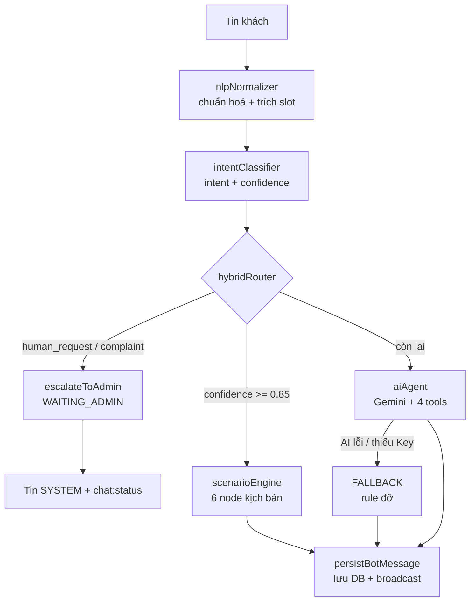

# Hybrid Chatbot — API & Kiến trúc (v3.1)

> **Version:** 3.1 · **Trạng thái:** ✅ Implemented · **Kiến trúc:** Hybrid (Rule-first → AI → Human)
>
> **Không breaking:** toàn bộ REST `/api/chat` và Socket.IO namespace `/chat` của v3.0 giữ nguyên.
> FE không cần sửa code, chỉ có thêm endpoint admin mới.

---

## 1. Vì sao đổi?

Bản v3.0 là **AI Chatbot thuần**: mọi tin nhắn đều gọi Gemini, chỉ khi lỗi/mất API key mới rớt về 4
câu `lower.includes` cứng. Hệ quả:

- Câu hỏi thường gặp (phí ship, bảo hành, tra cứu đơn) vẫn tốn token + 2–4 giây chờ.
- Không đo được tỉ lệ trúng intent ⇒ không biết chỗ nào cần cải thiện.
- Không có kịch bản vận hành được ⇒ đổi câu trả lời phải sửa code + deploy.

v3.1 bổ sung tầng **Rule kịch bản** đứng trước AI, cùng **FAQ vận hành trong MongoDB** và
**analytics đo hiệu suất**.

---

## 2. Luồng xử lý



**Ngưỡng quyết định:**

| Điều kiện | Route | Token | Độ trễ quyết định |
| :--- | :--- | :---: | :--- |
| `human_request` hoặc `complaint` | `HUMAN` | 0 | tức thì |
| `confidence >= 0.85` và rule xử lý được | `RULE` | 0 | < 50 ms |
| Còn lại | `AI` | có | 2–4 s |
| AI lỗi / thiếu `GEMINI_API_KEY` | `FALLBACK` | 0 | tức thì |

`confidence` = `min(1, điểm / 4)`. Điểm: khớp cụm từ chính quy `+3`, khớp từ khoá đơn `+1`,
có slot liên quan `+1`.

---

## 3. Cấu trúc module

```text
backend/src/modules/chat/bot/
  hybridRouter.ts       # cửa ngõ duy nhất: route()
  aiAgent.ts            # gọi Gemini + chạy tool + persistBotMessage
  scenarioEngine.ts     # máy trạng thái 6 node
  intentClassifier.ts   # rule intent + confidence
  nlpNormalizer.ts      # chuẩn hoá tiếng Việt + trích slot
  faqStore.ts           # truy cập FAQ (cache 60s)
  analyticsService.ts   # ghi & tổng hợp báo cáo
  copy.ts               # nguồn nội dung hội thoại DUY NHẤT
  prompts/
    systemPrompt.v2.ts # prompt version hoá
  tools/
    searchProducts.tool.ts
    lookupOrder.tool.ts
    faqSearch.tool.ts   # mới
    escalate.tool.ts    # nguồn duy nhất cho chuyển viên
```

`services/ai/chatbotService.ts` giữ lại làm **facade** (`processAiChatMessage` → gọi `hybridRouter.route`).

---

## 4. Intent nhận diện được

| Intent | Ví dụ câu khách | Route |
| :--- | :--- | :--- |
| `greeting` | "Xin chào" | RULE |
| `thanks` | "Cảm ơn bạn" | RULE |
| `human_request` | "Cho tôi gọi nhân viên" | **HUMAN** |
| `complaint` | "Tôi muốn khiếu nại đơn bị sai" | **HUMAN** |
| `order_lookup` | "Tra cứu đơn hàng BYC-2026-9812" | RULE |
| `price_consult` | "Cây 1m8 giá bao nhiêu" | RULE (consult_tree) |
| `faq_highfreq` | "Phí giao hàng bao nhiêu" | RULE (đọc `ChatFaq`) |
| `smalltalk` / `unknown` | — | AI |

### 4.1 Slot trích được tự động

| Slot | Nhận dạng | Ví dụ |
| :--- | :--- | :--- |
| `size` | `1m8`, `1.8m`, `180cm`, `size L` | "1m8" → `L` (180cm) |
| `maxPrice` | `2tr`, `2 triệu`, `dưới 3 triệu` | "dưới 2tr" → 2 000 000 |
| `minPrice` | `từ 1tr`, `trên 5tr` | "từ 1tr" → 1 000 000 |
| `orderCode` | `BYC-2026-9812`, ObjectId 24 hex | |
| `phone` | 10 số VN, `+84...` | "+84901234567" → "0901234567" |
| `style` | classic / nordic / luxury | "phong cách nordic" |
| `space` | phòng khách / sảnh / văn phòng | |

---

## 5. Tool của AI

| Tool | Chức năng | Ghi chú |
| :--- | :--- | :--- |
| `search_products` | Tìm cây thông + phụ kiện | Hỗ trợ `type`, `maxPrice`, `minPrice`, `size` |
| `lookup_order` | Tra cứu đơn theo mã / SĐT | Khoanh vùng `buyerId`; guest giới hạn 3 lần/10 phút |
| `faq_search` | Tra FAQ đã duyệt | Tool **mới** — chống ảo giác về chính sách |
| `escalate_to_admin` | Chuyển tư vấn viên | Nguồn duy nhất, idempotent |

---

## 6. Endpoint mới (Admin)

Tất cả yêu cầu `Authorization: Bearer <token>` + role `admin`.

### 6.1 `GET /api/chat/admin/faqs`

Query: `?intent=&isActive=&page=&limit=`

```json
{
  "faqs": [
    {
      "_id": "6724...",
      "intent": "shipping_fee",
      "question": "Phí giao hàng là bao nhiêu?",
      "answer": "Dạ phí giao hàng là 30.000đ ạ.",
      "keywords": ["phi ship", "phi giao hang"],
      "synonyms": ["tien ship"],
      "quickReplies": ["Thời gian giao hàng"],
      "matchThreshold": 1,
      "priority": 100,
      "isActive": true
    }
  ],
  "pagination": { "page": 1, "limit": 50, "total": 20, "totalPages": 1 }
}
```

### 6.2 `POST /api/chat/admin/faqs`

Body: `{ "intent": "shipping_fee", "question": "...", "answer": "...", "keywords": [], "synonyms": [], "quickReplies": [], "priority": 100 }`

Response **201**: `{ "faq": { ... } }`

### 6.3 `PUT /api/chat/admin/faqs/:id`

Body: bất kỳ subset của `{ question, answer, keywords, synonyms, quickReplies, intent, matchThreshold, priority, isActive }`

Response **200**: `{ "faq": { ... } }` — cache FAQ được invalidate tự động.

### 6.4 `DELETE /api/chat/admin/faqs/:id`

Xoá mềm (`isActive = false`). Response **200**: `{ "success": true, "faq": { ... } }`

### 6.5 `GET /api/chat/admin/analytics`

Query: `?days=7` (mặc định 7, tối đa 90)

```json
{
  "summary": {
    "total": 128,
    "routeRates": { "RULE": 0.62, "AI": 0.28, "HUMAN": 0.1 },
    "routeCounts": { "RULE": 79, "AI": 36, "HUMAN": 13 },
    "topIntents": [{ "intent": "faq_highfreq", "count": 41 }],
    "avgLatencyMs": { "RULE": 12, "AI": 2340 },
    "escalationRate": 0.1016,
    "avgSatisfaction": 4.3,
    "windowDays": 7
  },
  "gaps": [
    { "intent": "return_policy", "count": 9, "sampleInputs": ["cho doi tra nha"] }
  ]
}
```

`gaps` là danh sách intent hay rơi sang AI/FALLBACK ⇒ ứng viên nên viết thêm FAQ.

---

## 7. Model mới / mở rộng

### 7.1 `Conversation` (bổ sung, tương thích ngược)

```typescript
scenarioState: {
  currentNode: "greeting" | "consult_tree" | "order_lookup" | "faq_highfreq" | "complaint_handoff" | "closing_csat",
  slots: { size?, maxPrice?, minPrice?, orderCode?, phone?, style?, space? },
  attempts: number,   // số lần AI không tìm thấy liên tiếp
  visited: string[]
}
lastIntent?: string
handoffReason?: string
satisfaction?: number   // 1..5
```

### 7.2 `ChatFaq` (collection mới)

```typescript
{ intent, question, answer, keywords[], synonyms[], quickReplies[],
  matchThreshold, priority, isActive }
```

`intent` ∈ `shipping_fee | delivery_time | installation | warranty | invoice | payment | return_policy | bulk_order | tree_care | other`

### 7.3 `ChatLog` (collection mới)

```typescript
{ conversationId, input, normalized, intent, confidence, route,
  slots, latencyMs, toolsUsed[], escalated, reason, satisfaction }
```

`route` ∈ `RULE | AI | HUMAN | FALLBACK`

---

## 8. Nạp dữ liệu FAQ mẫu

```bash
cd backend
npm run seed:chat-faq
```

Script **idempotent** (upsert theo `question`), nạp 20 FAQ mẫu phủ: phí ship, thời gian giao,
lắp đặt, bảo hành, hoá đơn, thanh toán, đổi trả, mua sỉ, chăm sóc cây, kích thước.

---

## 9. Kiểm thử

```bash
npm run test:chat     # 4 file: chat, chatUnified, chatHybrid, chatHybridIntegration
npm run test:all      # toàn bộ suite
```

| File | Phạm vi |
| :--- | :--- |
| `chatHybrid.test.ts` | Unit: chuẩn hoá, từ đồng nghĩa, trích slot, phân loại intent, CSAT, prompt |
| `chatHybridIntegration.test.ts` | Tích hợp MongoDB: route RULE/AI/HUMAN, escalate idempotent, chặn tra chéo đơn, rate-limit SĐT, analytics, IDOR,降级 khi mất API key |

Kết quả hiện tại: **50/50 pass** (integration) và **toàn bộ `test:all` exit 0**.

---

## 10. Hướng dẫn cho Frontend

**Không cần sửa gì.** Toàn bộ DTO và event Socket v3.0 giữ nguyên.

Điểm mới để biết:

1. **Bot có thể trả lời tức thì** bằng Rule (chưa từng gọi AI). FE vẫn nhận `chat:message` bình thường.
2. **`metadata.quickReplies`** giờ xuất hiện ở nhiều node hơn (greeting, consult, FAQ, order lookup).
   FE đã hỗ trợ sẵn theo `FE_CHAT_INTEGRATION_GUIDE.md` §6.1.
3. **`metadata.suggestedProducts`** có thể chứa `type: "accessory"` (ngoài `"tree"`).
   FE nên render theo `type` thay vì hard-code "tree".
4. **`metadata.orderInfo`** giờ có cả `orderCode` và `orderNumber` (tương thích ngược).
5. Khi bot escalate, khách nhận **2 tin**: 1 tin `SYSTEM` ("Đã gửi yêu cầu kết nối...") và
   1 tin `BOT` xác nhận, kèm event `chat:status` với `status: "WAITING_ADMIN"`.
   FE nên hiển thị trạng thái "Đang chờ tư vấn viên".

### 10.1 Thêm thanh trạng thái handoff (khuyến nghị)

```typescript
chatSocket.on("chat:status", ({ conversationId, status, assignedAdmin }) => {
  if (status === "WAITING_ADMIN") {
    showBanner("Đang chờ tư vấn viên phản hồi…");
  } else if (status === "ADMIN_ACTIVE" && assignedAdmin) {
    showBanner(`${assignedAdmin.name} đang phụ trách cuộc trò chuyện`);
  }
});
```
