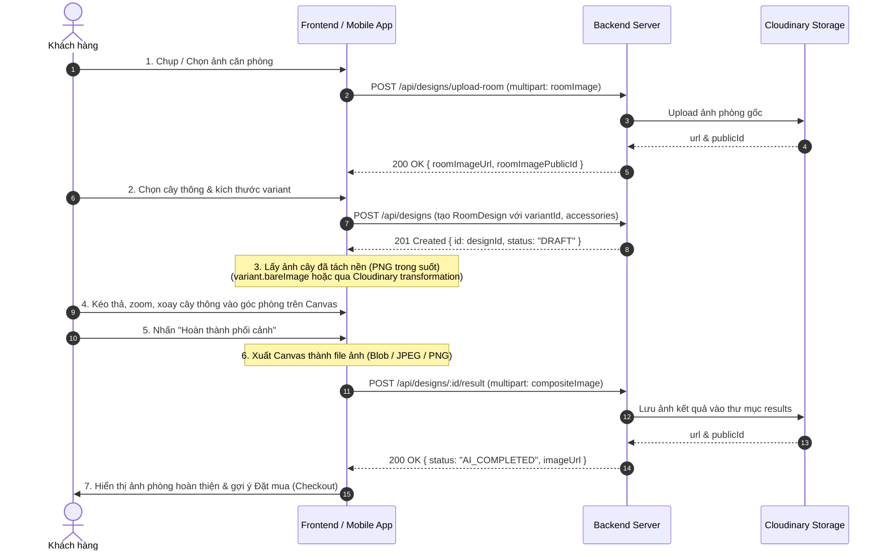

# Frontend & Mobile Room Design Compositing Guide

> **Mục tiêu:** Hướng dẫn đội ngũ Frontend và Mobile chuyển đổi tính năng phối cảnh phòng từ cơ chế AI render chậm (KIE/SDXL trên server) sang cơ chế **Client-side Compositing (Ghép ảnh trực quan tức thì)**.
> **API Mới:** `POST /api/designs/:id/result`
> **Trạng thái:** ✅ Backend đã sẵn sàng & phản hồi đồng bộ `AI_COMPLETED` (không cần polling).

---

## 1. Tổng Quan & Lý Do Thay Đổi

### 1.1 Vấn đề của cơ chế cũ (Server-side AI Generation)
1. **Thời gian chờ đợi quá lâu:** Mỗi lần render AI mất từ 35 đến 60 giây, dễ bị lỗi timeout (504 Gateway Timeout trên Render).
2. **Sai lệch sản phẩm thực tế:** AI tự vẽ lại cây thông nên cây kết quả không giống 100% với cây khách chọn mua trong giỏ hàng.
3. **Chi phí và phụ thuộc Upstream:** Thường xuyên lỗi `KIE_KEY_MISSING` hoặc hết quota render.
4. **Trải nghiệm thụ động:** Khách không thể kéo thả vị trí, chỉnh góc nghiêng hoặc phóng to thu nhỏ cây theo ý muốn trong căn phòng của mình.

### 1.2 Lợi ích vượt trội của Client-side Compositing
1. **Phản hồi tức thì (Zero-Latency):** Khách thấy ngay kết quả ghép cây vào phòng trong 0.1 giây.
2. **Toàn quyền tương tác (WYSIWYG):** Khách dùng ngón tay hoặc chuột kéo thả cây tới góc phòng mong muốn, phóng to/thu nhỏ đúng tỉ lệ phòng khách.
3. **Chính xác 100%:** Cây và phụ kiện hiển thị đúng hình dạng, màu sắc hàng thật chuẩn bị giao.
4. **Đồng bộ kết quả 1 bước:** Client gửi ảnh canvas hoàn chỉnh lên `POST /api/designs/:id/result`, Backend lưu Cloudinary và gán trạng thái `AI_COMPLETED` ngay lập tức mà không cần polling kiểm tra tiến độ.

---

## 2. Quy Trình Phối Cảnh Chi Tiết (Step-by-Step Flow)



---

## 3. Chi Tiết Từng Bước Tích Hợp

### Bước 1: Upload ảnh phòng gốc
- **Endpoint:** `POST /api/designs/upload-room`
- **Headers:** `Authorization: Bearer <token>`, `Content-Type: multipart/form-data`
- **Form Data Field:** `roomImage` (File ảnh JPEG/PNG/WebP, dung lượng tối đa 8 MB).
- **Phản hồi mẫu 200 OK:**
  ```json
  {
    "success": true,
    "data": {
      "roomImageUrl": "https://res.cloudinary.com/byc/image/upload/v1/buildyourchristmas/room-designs/rooms/room_123.jpg",
      "roomImagePublicId": "buildyourchristmas/room-designs/rooms/room_123"
    }
  }
  ```

---

### Bước 2: Tạo thiết kế (RoomDesign)
- **Endpoint:** `POST /api/designs`
- **Headers:** `Authorization: Bearer <token>`, `Content-Type: application/json`
- **Body:**
  ```json
  {
    "title": "Phòng khách Giáng Sinh 2026",
    "roomImageUrl": "https://res.cloudinary.com/byc/image/upload/v1/buildyourchristmas/room-designs/rooms/room_123.jpg",
    "roomImagePublicId": "buildyourchristmas/room-designs/rooms/room_123",
    "treeVariantId": "6723f8b01234567890abcdef",
    "selectedAccessories": [
      { "accessoryId": "6723f9901234567890abcdef", "quantity": 4 }
    ]
  }
  ```
- **Phản hồi 201 Created:** Trả về đối tượng `design` kèm trường `id` (ObjectId).

---

### Bước 3: Chuẩn bị tài nguyên Cây thông đã tách nền (Transparent Assets)

Để cây thông hiển thị tự nhiên trên nền phòng khách, ảnh cây phải có nền trong suốt (PNG/WebP transparent):
1. **Cách 1 (Khuyến nghị - Nhanh nhất):**
   - Trong dữ liệu Catalog, mỗi `TreeVariant` đã có sẵn URL ảnh cây đã tách nền chuẩn Studio tại trường `variant.bareImage` hoặc `tree.thumbnailUrl`.
2. **Cách 2 (Tách nền động bằng Cloudinary URL transformation):**
   - Thêm cờ `e_background_removal` vào URL ảnh Cloudinary:
     `https://res.cloudinary.com/byc/image/upload/e_background_removal/v1/trees/noble_fir.png`
3. **Cách 3 (Tách nền tại Client bằng AI WASM):**
   - Web: Thư viện `@imgly/background-removal` chạy trực tiếp trên GPU máy khách.
   - Mobile: Thư viện `@pchmn/expo-background-removal` chạy trên thiết bị di động.

---

### Bước 4: Tải ảnh ghép hoàn thiện lên Backend (`POST /api/designs/:id/result`)

Sau khi người dùng căn chỉnh cây trên Canvas và xác nhận, Client xuất canvas thành `Blob` hoặc `File` rồi gửi lên API.

- **Endpoint:** `POST /api/designs/:id/result`
- **Headers:** `Authorization: Bearer <token>`, `Content-Type: multipart/form-data`
- **Form Data Fields:**
  - `compositeImage` *(bắt buộc)*: File ảnh kết quả (JPEG hoặc PNG, tối đa 8 MB).
  - `clientPrompt` *(tùy chọn)*: Ghi chú vị trí hoặc mô tả của khách, ví dụ: `"Cây thông 1m8 đặt cạnh sofa phòng khách"`.
- **Phản hồi 200 OK:**
  ```json
  {
    "success": true,
    "data": {
      "designId": "6724b1029102...",
      "status": "AI_COMPLETED",
      "imageUrl": "https://res.cloudinary.com/byc/image/upload/v1/buildyourchristmas/room-designs/results/res_456.jpg",
      "imagePublicId": "buildyourchristmas/room-designs/results/res_456",
      "compositeSource": "CLIENT"
    }
  }
  ```
- **Lưu ý đặc biệt:**
  - `status` sẽ được đặt ngay thành `"AI_COMPLETED"`.
  - Frontend **KHÔNG CẦN** gọi polling hay hẹn giờ kiểm tra trạng thái nữa.

---

## 4. Code Mẫu Triển Khai (Implementation Examples)

### 4.1 Web: React + HTML5 Canvas Component

```tsx
import React, { useRef, useState, useEffect } from "react";

interface CompositeEditorProps {
  designId: string;
  roomImageUrl: string;
  treeTransparentUrl: string;
  authToken: string;
  onSuccess: (resultUrl: string) => void;
}

export const RoomCompositeEditor: React.FC<CompositeEditorProps> = ({
  designId,
  roomImageUrl,
  treeTransparentUrl,
  authToken,
  onSuccess,
}) => {
  const canvasRef = useRef<HTMLCanvasElement | null>(null);
  const [treePos, setTreePos] = useState({ x: 200, y: 150, scale: 0.8 });
  const [isSubmitting, setIsSubmitting] = useState(false);

  // Vẽ Canvas nền phòng + Cây thông
  const renderCanvas = () => {
    const canvas = canvasRef.current;
    if (!canvas) return;
    const ctx = canvas.getContext("2d");
    if (!ctx) return;

    const roomImg = new Image();
    roomImg.crossOrigin = "anonymous";
    roomImg.src = roomImageUrl;
    roomImg.onload = () => {
      canvas.width = roomImg.naturalWidth;
      canvas.height = roomImg.naturalHeight;
      // 1. Vẽ ảnh căn phòng
      ctx.drawImage(roomImg, 0, 0);

      // 2. Vẽ cây thông đè lên
      const treeImg = new Image();
      treeImg.crossOrigin = "anonymous";
      treeImg.src = treeTransparentUrl;
      treeImg.onload = () => {
        const treeW = treeImg.naturalWidth * treePos.scale;
        const treeH = treeImg.naturalHeight * treePos.scale;
        ctx.drawImage(treeImg, treePos.x, treePos.y, treeW, treeH);
      };
    };
  };

  useEffect(() => {
    renderCanvas();
  }, [roomImageUrl, treeTransparentUrl, treePos]);

  // Xuất ảnh và gửi lên API Backend
  const handleSaveComposite = async () => {
    const canvas = canvasRef.current;
    if (!canvas) return;
    setIsSubmitting(true);

    canvas.toBlob(async (blob) => {
      if (!blob) {
        alert("Lỗi khi xuất ảnh từ canvas");
        setIsSubmitting(false);
        return;
      }

      try {
        const formData = new FormData();
        formData.append("compositeImage", blob, "room_composite.png");
        formData.append("clientPrompt", "Phối cảnh phòng khách tự ghép");

        const res = await fetch(`/api/designs/${designId}/result`, {
          method: "POST",
          headers: {
            Authorization: `Bearer ${authToken}`,
          },
          body: formData,
        });

        const data = await res.json();
        if (!res.ok) throw new Error(data.message || "Upload thất bại");

        onSuccess(data.data.imageUrl);
      } catch (err: any) {
        alert("Lỗi khi lưu thiết kế: " + err.message);
      } finally {
        setIsSubmitting(false);
      }
    }, "image/png");
  };

  return (
    <div className="flex flex-col items-center gap-4 p-4">
      <div className="relative border rounded-lg overflow-hidden max-w-full">
        <canvas ref={canvasRef} className="max-h-[500px] w-auto cursor-move" />
      </div>

      <div className="flex items-center gap-4">
        <label className="text-sm">Kích cỡ cây:</label>
        <input
          type="range"
          min="0.3"
          max="2.0"
          step="0.05"
          value={treePos.scale}
          onChange={(e) =>
            setTreePos((prev) => ({ ...prev, scale: parseFloat(e.target.value) }))
          }
        />

        <button
          onClick={handleSaveComposite}
          disabled={isSubmitting}
          className="px-6 py-2 bg-emerald-600 text-white rounded font-medium disabled:opacity-50"
        >
          {isSubmitting ? "Đang lưu ảnh..." : "Lưu phối cảnh phòng"}
        </button>
      </div>
    </div>
  );
};
```

---

### 4.2 Mobile: React Native Skia / ViewShot Snippet

```tsx
import React, { useRef, useState } from "react";
import { View, Image, StyleSheet, TouchableOpacity, Text, ActivityIndicator } from "react-native";
import ViewShot, { captureRef } from "react-native-view-shot";

export const MobileRoomComposite = ({
  designId,
  roomImageUrl,
  treeTransparentUrl,
  authToken,
  onComplete,
}: any) => {
  const viewShotRef = useRef<any>(null);
  const [loading, setLoading] = useState(false);

  const onConfirm = async () => {
    try {
      setLoading(true);
      // Chụp ảnh khu vực View phối cảnh
      const uri = await captureRef(viewShotRef, {
        format: "png",
        quality: 0.95,
      });

      const formData = new FormData();
      formData.append("compositeImage", {
        uri,
        name: "mobile_composite.png",
        type: "image/png",
      } as any);

      const response = await fetch(`https://api.buildyourchristmas.com/api/designs/${designId}/result`, {
        method: "POST",
        headers: {
          Authorization: `Bearer ${authToken}`,
          "Content-Type": "multipart/form-data",
        },
        body: formData,
      });

      const json = await response.json();
      if (!response.ok) throw new Error(json.message);

      onComplete(json.data.imageUrl);
    } catch (e: any) {
      alert("Lỗi upload: " + e.message);
    } finally {
      setLoading(false);
    }
  };

  return (
    <View style={styles.container}>
      <ViewShot ref={viewShotRef} options={{ format: "png", quality: 0.95 }} style={styles.stage}>
        {/* Ảnh nền căn phòng */}
        <Image source={{ uri: roomImageUrl }} style={styles.roomImage} resizeMode="cover" />
        {/* Lớp cây thông trong suốt kéo thả */}
        <Image source={{ uri: treeTransparentUrl }} style={styles.treeLayer} resizeMode="contain" />
      </ViewShot>

      <TouchableOpacity style={styles.btn} onPress={onConfirm} disabled={loading}>
        {loading ? <ActivityIndicator color="#fff" /> : <Text style={styles.btnText}>Hoàn Thành Phối Cảnh</Text>}
      </TouchableOpacity>
    </View>
  );
};

const styles = StyleSheet.create({
  container: { flex: 1, alignItems: "center" },
  stage: { width: 340, height: 420, borderRadius: 12, overflow: "hidden", position: "relative" },
  roomImage: { width: "100%", height: "100%" },
  treeLayer: { position: "absolute", bottom: 20, left: 70, width: 200, height: 300 },
  btn: { marginTop: 16, paddingVertical: 12, paddingHorizontal: 24, backgroundColor: "#047857", borderRadius: 8 },
  btnText: { color: "#fff", fontWeight: "700" },
});
```

---

## 5. Danh Sách Mã Lỗi Cần Xử Lý

| HTTP Status | Mã Lỗi (`code`) | Nguyên nhân & Hướng giải quyết |
| :--- | :--- | :--- |
| **400** | `INVALID_INPUT` | `id` không phải ObjectId hợp lệ. Kiểm tra URL params. |
| **400** | `COMPOSITE_IMAGE_REQUIRED` | Thiếu file trong `req.file`. Hãy đảm bảo tên field trong FormData là `compositeImage`. |
| **400** | `FILE_TOO_LARGE` | File ảnh vượt quá 8 MB. Client nên nén trước khi upload. |
| **403** | `FORBIDDEN` | Người dùng hiện tại không phải chủ sở hữu của thiết kế này. |
| **404** | `DESIGN_NOT_FOUND` | Thiết kế không tồn tại hoặc đã bị xoá. |
| **410** | `ENDPOINT_GONE` | Đang gọi endpoint cũ `POST /:id/generate-image` đã ngừng cung cấp dịch vụ. Cần chuyển sang `POST /:id/result`. |
| **415** | `UNSUPPORTED_MEDIA_TYPE` | File không thuộc định dạng JPEG, PNG hoặc WebP. |
| **502** | `UPSTREAM_ERROR` | Lỗi khi truyền file sang Cloudinary. |
